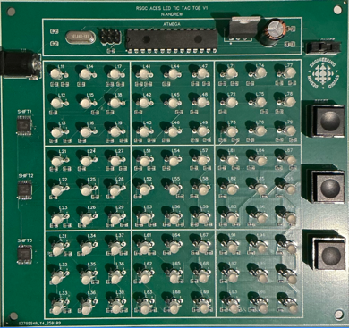
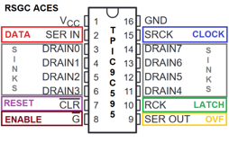
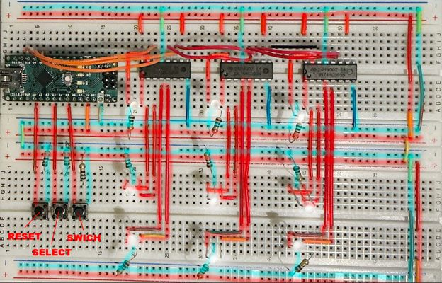
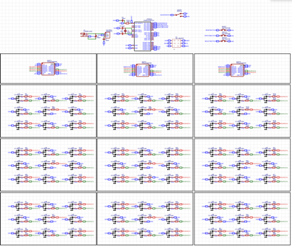
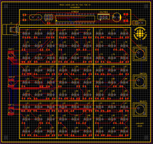
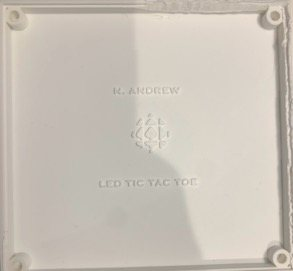

# LED Tic-Tac-Toe

A two-player Tic-Tac-Toe game played on a 3x3 grid of bi-colour LED tiles, driven by an ATmega328P and three TPIC6C595 shift registers. Players take turns picking a tile with pushbuttons; red and green mark each player's moves and the game detects wins and draws.

<p align="center">
  
</p>


## Overview

The project demonstrates digital signal control, user interaction and electronic prototyping. Each tile is a bi-colour LED; the microcontroller shifts out binary data through cascaded shift registers, and that data decides which LEDs glow red, green or flashing orange (the currently selected tile).

**Game states**

| Value | Meaning |
|-------|---------|
| `0` | Tile open |
| `1` | Player 1 (red) |
| `2` | Player 2 (green) |

The selected tile flashes while the player chooses. The firmware tracks the board, the current player, the move count and the winner.

## Hardware

| Part | Role |
|------|------|
| ATmega328P (Arduino Nano for the prototype) | Game logic |
| 3x TPIC6C595 power shift registers | Drive the bi-colour LED tiles |
| Bi-colour (red/green) LEDs | 3x3 game board |
| Pushbuttons | Reset, switch tile, select tile, plus on/off switch on the PCB |

The TPIC6C595 uses DATA, CLOCK, LATCH, RESET and ENABLE pins and has seven open-drain outputs plus a serial output so several chips can be cascaded.

| TPIC6C595 pinout | Breadboard prototype |
|:---:|:---:|
|  |  |

| Schematic | PCB layout |
|:---:|:---:|
|  |  |

| 3D-printed case |
|:---:|
|  |

## Repository layout

```
led-tic-tac-toe/
├── firmware/
│   ├── tictactoe_breadboard/   # Prototype (Arduino Nano pins)
│   └── tictactoe_pcb/          # Final PCB (standalone ATmega328P pins)
├── docs/images/
├── LICENSE
└── README.md
```

## Build and run

1. Open the sketch that matches your hardware and upload it.
2. Use the buttons to move the flashing selector, then confirm a tile. First to complete a row, column or diagonal wins.
3. Use the serial monitor to inspect the game state during testing.

## What I learned

- Cascading shift registers to drive far more LEDs than the MCU has pins
- Representing game state as data and converting it to a physical display
- Differences between a breadboard prototype and a standalone ATmega328P PCB build
- Designing a PCB and a 3D-printed enclosure for a finished product

## Credits and notes

An ISP (independent study project) in the ACES Computer Engineering course (2025). MIT licensed.
